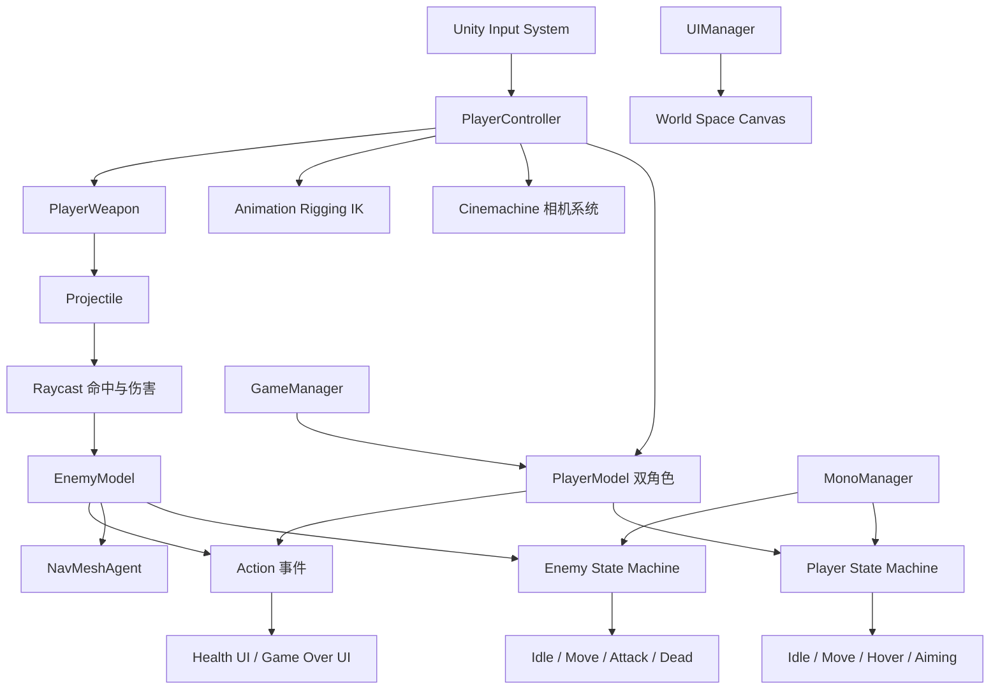
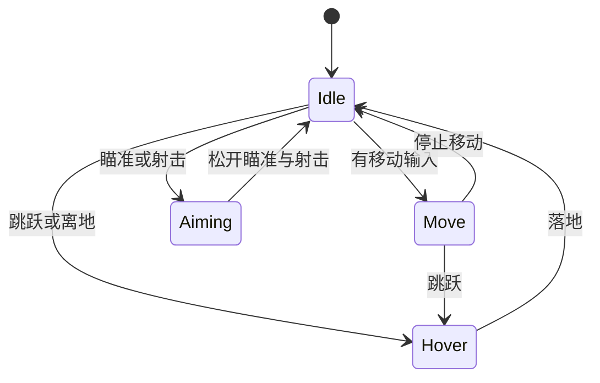
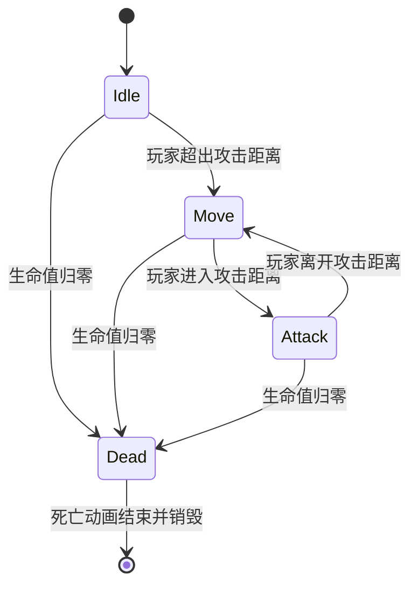

# ElementWar | 枪战二次元

基于 Unity 开发的第三人称动作射击原型，采用数据与表现分离、事件驱动和有限状态机驱动的工程化架构。项目包含双角色切换、移动与瞄准、射击与命中反馈、丧尸 AI、血量恢复、场景异步加载以及完整的菜单与战斗 UI 流程。

项目地址：<https://github.com/jituihaochi001-arch/ElementWar>

## 项目概览

| 项目 | 说明 |
| --- | --- |
| 项目类型 | 第三人称动作射击 / FPS 原型 |
| 引擎版本 | Unity 2022.3.62f3c1 |
| 渲染管线 | Universal Render Pipeline 14.0.12 |
| 主要语言 | C# |
| 核心玩法 | 双角色切换、移动、冲刺、跳跃、瞄准、射击、丧尸战斗 |
| 目标平台 | Windows PC |
| 工程特点 | 状态机驱动、事件解耦、Manager 层统一管理、动画与物理融合 |

## 核心亮点

- 自研泛型有限状态机，统一管理玩家与敌人的状态生命周期，并通过字典缓存状态实例，避免重复创建。
- 玩家与敌人共享状态机设计思想，但根据角色职责扩展为独立的 `PlayerStateBase` 和 `EnemyStateBase`。
- 双角色运行模型：当前角色由 `CharacterController` 和动画驱动移动，非当前角色由 `NavMeshAgent` 自动追踪，实现跟随与切换。
- 使用 Cinemachine 管理自由视角与瞄准视角，通过相机优先级完成平滑切换，并结合 Impulse 实现射击震屏。
- 使用 Animation Rigging 的 IK 和 Aim Constraint 处理持枪、瞄准和上半身朝向，实现动画与武器表现解耦。
- 事件驱动 UI：角色切换、血量变化和死亡事件由 `Action` 事件广播，UI 只订阅自己关心的数据变更。
- 子弹采用 Rigidbody 运动，并通过逐帧线段 Raycast 进行连续碰撞检测，降低高速子弹穿透目标的问题。
- 场景加载使用 `SceneManager.LoadSceneAsync`，配合进度条 UI 提升加载过程的表现完整性。

## 玩法说明

- 使用 `WASD` 或方向键移动。
- 使用鼠标控制视角。
- 按住 `Shift` 冲刺。
- 按 `Space` 跳跃。
- 按住鼠标右键进入瞄准状态。
- 按住鼠标左键射击。
- 按 `1`、`2` 切换角色。
- 角色受到伤害后会进入受伤状态；脱离伤害一段时间后自动恢复生命值。
- 丧尸会通过 NavMesh 追踪玩家，在进入攻击距离后执行近战攻击。

## 技术栈

### Unity

- Unity 2022.3.62f3c1
- Universal Render Pipeline
- Cinemachine
- Animation Rigging
- AI Navigation
- Input System
- TextMeshPro
- UGUI

### C# 与工程实践

- 泛型与泛型约束
- 抽象类、接口和多态
- 有限状态机
- 单例基类
- 事件与委托
- 协程
- 面向组件设计
- 事件订阅生命周期管理

### 游戏开发能力

- CharacterController 角色移动
- NavMesh 寻路与敌人 AI
- Rigidbody 弹道与物理模拟
- Raycast 命中检测
- Animator Root Motion
- IK 骨骼约束
- 动画事件与状态切换
- 异步场景加载
- URP 与全局后处理

## 系统架构



### 分层职责

- `Assets/Scripts/Base`：状态机基类、角色模型基类、单例基类和 UI 基类。
- `Assets/Scripts/Manager`：全局管理器层，负责玩家集合、统一 Update 调度和世界空间 UI。
- `Assets/Scripts/Player`：玩家控制、角色模型、武器和玩家状态。
- `Assets/Scripts/Enemy`：敌人抽象模型和丧尸状态。
- `Assets/Scripts/UI`：菜单、加载、提示、游戏结束和血量 UI。
- `Assets/Scripts/Utils`：状态机、准星目标等通用工具。
- `Assets/Settings/Input System`：Input Actions 资产和自动生成的输入封装。

## 核心模块设计

### 1. 有限状态机

状态机位于 `Assets/Scripts/Utils/StateMachine.cs`，状态基类位于 `Assets/Scripts/Base/StateBase.cs`。

核心设计：

- `IStateMachineOwner` 负责连接状态机与宿主对象。
- `StateMachine` 使用 `Dictionary<Type, StateBase>` 缓存状态实例。
- 状态统一实现 `Init / Enter / Update / Exit / Destroy` 生命周期。
- 状态更新通过 `MonoManager` 注册和注销，避免每个状态单独依赖 `MonoBehaviour.Update`。
- 玩家状态包括 `Idle`、`Move`、`Hover`、`Aiming`。
- 敌人状态包括 `Idle`、`Move`、`Attack`、`Dead`。





### 2. 玩家控制与双角色切换

`PlayerController` 是玩家输入和相机表现的中枢：

- 读取移动、冲刺、瞄准、跳跃、射击和角色切换输入。
- 将屏幕方向输入转换为世界空间移动方向，再转换为角色本地空间方向。
- 管理 `currentModel`，通过 `OnPlayerModelChanged` 通知 UI 和相机更新。
- 管理自由视角和瞄准视角的优先级切换。
- 通过 `CinemachineImpulseSource` 提供射击震屏反馈。
- 通过事件 `OnDeath` 通知游戏结束 UI。

`PlayerModel` 负责角色自身的物理、动画和生命值：

- 当前受控角色使用 `CharacterController` 和 Animator Root Motion 移动。
- 非受控角色启用 `NavMeshAgent`，自动向当前角色靠近。
- 使用 `OnAnimatorMove` 读取动画位移，使移动表现与动画同步。
- 使用最近三帧速度缓存，在跳跃或空中状态下保持运动连续性。
- 使用事件 `OnHealthChanged` 向 UI 推送生命值变化。

### 3. 相机与动画约束

- `CinemachineFreeLook` 提供普通第三人称视角。
- 第二个 `CinemachineFreeLook` 提供瞄准视角。
- 通过 Priority 切换相机，并同步两个相机的旋转值，避免切换时跳变。
- `TwoBoneIKConstraint` 用于持枪手部约束。
- `MultiAimConstraint` 用于瞄准时手部和身体朝向约束。
- `HeadAimTarget` 通过射线与平面求交，让头部或准星目标跟随鼠标。

### 4. 武器、弹道与命中

武器逻辑拆分为 `PlayerWeapon` 和 `PlayerWeaponBullet`：

- `PlayerWeapon` 负责射速控制、子弹生成、枪口特效和发射方向计算。
- `PlayerWeaponBullet` 使用 Rigidbody 进行物理移动。
- 每帧记录上一帧位置，使用线段 Raycast 检查子弹是否穿过敌人。
- `CheckInitiaOverLap` 处理子弹生成时已经与敌人重叠的情况。
- 支持伤害倍率、生命周期、拖尾特效和受击特效。

### 5. 敌人与 NavMesh AI

`EnemyModel` 抽象敌人通用能力，`ZombieEnemy` 负责丧尸状态注册。

- `NavMeshAgent.SetDestination` 实现追踪。
- `EnemyState` 管理待机、移动、攻击和死亡。
- 攻击状态通过协程分离前摇、伤害判定和后摇。
- 攻击冷却避免短时间内重复造成伤害。
- 受伤时播放 Hit 动画、减慢移动速度并生成血液特效。
- 死亡后关闭导航和碰撞，播放死亡动画并销毁对象。

### 6. UI 与事件驱动

- `UIBase<T>` 封装 UI 单例、淡入淡出动画和按钮状态控制。
- `LoadingCanvas` 使用异步场景加载更新进度条。
- `PlayerHealthUI` 订阅角色切换和生命值变化事件。
- `GameOverUI` 订阅玩家死亡事件，并禁用玩家输入。
- `EnemyHealthUI` 使用 Billboard 旋转，让敌人血条始终面向主相机。
- `ExcludeMouse` 与 `TMPGlowControl` 提供交互式菜单动效。

## 工程结构

```text
Assets/
├── Scenes/
│   ├── GameStart.unity          # 主菜单入口场景
│   └── Game.unity               # 战斗场景
├── Scripts/
│   ├── Base/                    # 状态机、单例、玩家/敌人/UI 基类
│   ├── Manager/                 # GameManager、MonoManager、UIManager
│   ├── Player/
│   │   ├── PlayerController.cs
│   │   ├── PlayerModel.cs
│   │   ├── PlayerWeapon.cs
│   │   └── States/              # 玩家状态
│   ├── Enemy/
│   │   ├── ZombieEnemy.cs
│   │   └── State/               # 丧尸状态
│   ├── UI/                      # 菜单、加载、战斗 HUD
│   └── Utils/                   # 通用工具与状态机
├── Settings/Input System/       # Input Actions
├── Resources/                   # 模型、特效、材质、预制体
├── MagicaCloth2/                # 布料模拟插件
├── MMD4Mecanim/                 # MMD 模型导入与物理插件
├── Low Poly FPS Pack/           # FPS 武器与场景资源
├── EffectCore/                  # 特效资源
└── YSA Toon/                    # 卡通渲染相关资源
```

## 快速开始

### 环境要求

- Unity Hub
- Unity 2022.3.62f3c1
- Git LFS

### 克隆项目

```powershell
git lfs install
git clone https://github.com/jituihaochi001-arch/ElementWar.git
cd ElementWar
git lfs pull
```

### 运行项目

1. 使用 Unity Hub 添加项目目录。
2. 使用 Unity `2022.3.62f3c1` 打开项目。
3. 打开 `Assets/Scenes/GameStart.unity`。
4. 点击 Play，从主菜单进入游戏。
5. 构建时保持 `GameStart` 和 `Game` 两个场景的 Build Settings 顺序。

## 当前实现边界

已完成：

- 主菜单、提示、退出确认、加载、游戏结束 UI。
- 玩家双角色切换、移动、冲刺、跳跃、瞄准和射击。
- 丧尸 NavMesh AI、攻击、受伤、死亡与血条。
- 玩家血量恢复、受击、死亡与事件驱动 UI。
- 弹道、命中检测、受击特效、枪口特效和相机震屏。
- 异步场景加载。

规划中：

- 在线对战。
- 存档与继续游戏。
- 角色、服装和设置菜单。
- 更多敌人类型、武器类型和关卡。
- 更完整的音效、任务与数据配置系统。

## 第三方资源说明

项目中的 `MagicaCloth2`、`MMD4Mecanim`、`Low Poly FPS Pack`、`EffectCore`、`YSA Toon` 等目录属于第三方插件或资源包，主要用于美术、动画和物理效果验证。项目自研逻辑集中在 `Assets/Scripts` 目录。第三方资源的使用需遵循各自原始授权。

## 后续优化方向

- 将角色和武器数值迁移到 ScriptableObject，降低配置与逻辑耦合。
- 为状态机增加单元测试和编辑器可视化调试。
- 将伤害、命中、音效和特效拆分为更细粒度的领域事件。
- 增加对象池，优化子弹和受击特效实例化开销。
- 增加更完整的输入重绑定、UI 导航和手柄适配。
- 将全局 Manager 按生命周期拆分，减少静态单例依赖。
